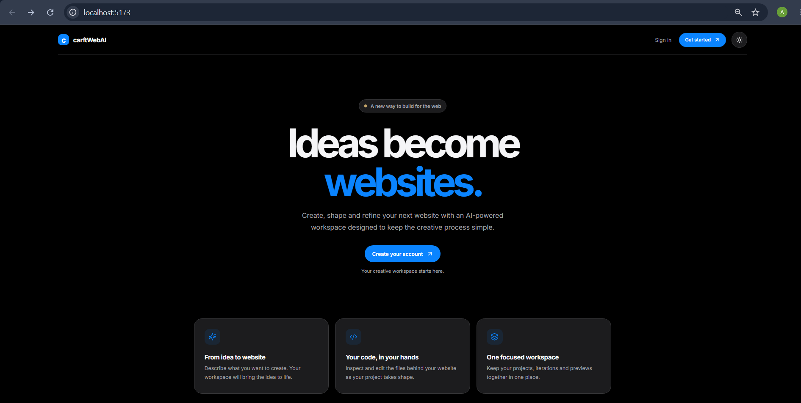
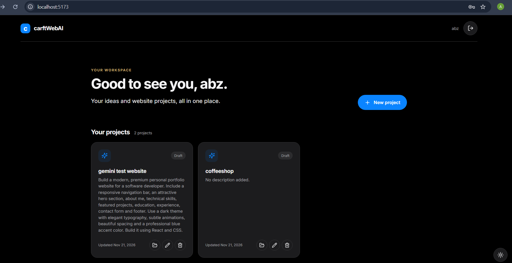
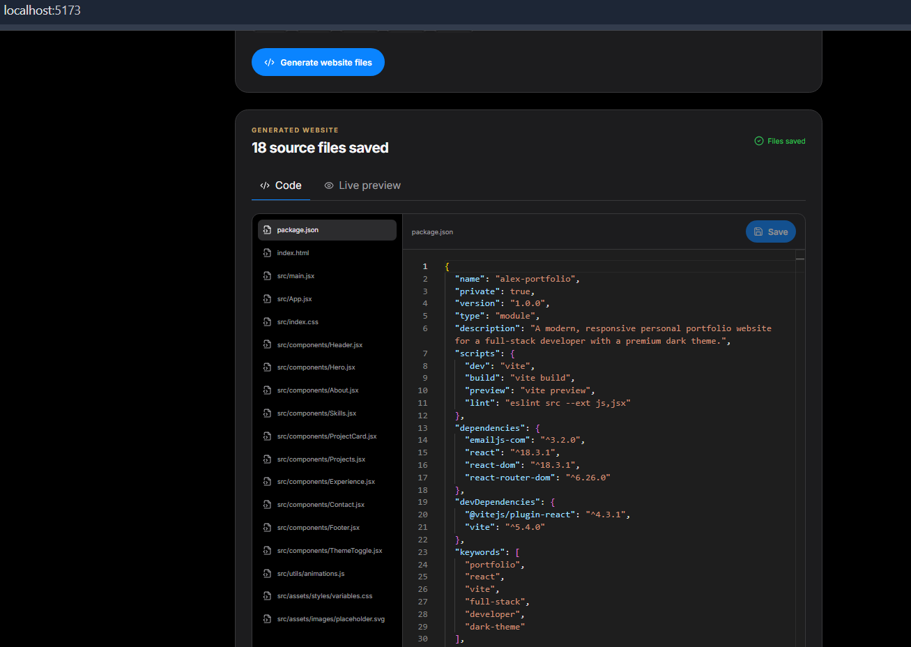
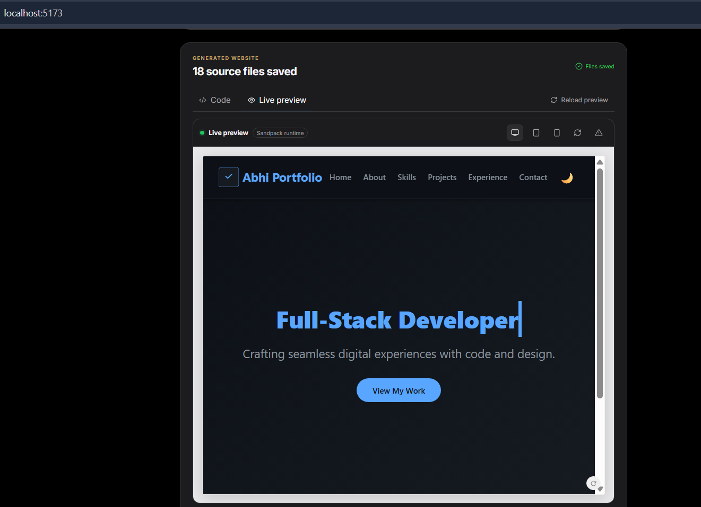

# craftWebAIWebAI

**Build websites with AI. Edit the code. Preview the result.**

craftWebAIWebAI is an AI-powered website builder that turns natural-language prompts into React website projects. It combines AI-assisted planning and code generation with project management, a code editor, and a live preview.

> **Current milestone: MVP v0.1.0** — the core prompt-to-website workflow is implemented and has been tested with the example projects documented below. This is a development MVP, not yet a production-ready public hosting platform.

### HomePage

### Dashboard

## Features

- **Authentication:** registration, sign-in, sign-out, password hashing, and JWT sessions in HttpOnly cookies.
- **Project management:** create, view, rename, and delete projects; project data is scoped to its owner.
- **AI website planning:** turn a prompt into a structured website plan and file manifest.
- **AI code generation:** generate React/Vite source files from the approved plan.
- **Code editor:** inspect and edit generated files in the project workspace using Monaco.
- **Persistent edits:** save generated-file changes to MongoDB so they remain after refresh.
- **Live preview:** view the generated website and switch between desktop, tablet, and mobile preview sizes.
- **Generation validation:** normalize common model-output issues, check generated files, report validation diagnostics, and safely correct selected JSX/import mistakes.

<!-- TODO: Add a real screenshot showing the code editor and generated file tree. -->
<!--  -->

<!-- TODO: Add a real screenshot of a successfully rendered generated website in the live preview. -->
<!--  -->

## How it works

1. The user creates a project and enters a website prompt.
2. The backend asks the configured AI model to create a plan and file manifest.
3. The backend generates the requested source files and saves them to the user's project.
4. Generated content is normalized and checked against the manifest.
5. The user reviews and edits the files in the code editor.
6. The live-preview workspace renders the generated website.

### AI Website Generation


### Code Editor and Live Preview


## Example generation tests

The following are observed test runs from development. They demonstrate two different prompt sizes; they are **not** a formal performance benchmark.

| Example prompt | Generated files | Observed result |
|---|---:|---|
| Full-stack developer portfolio with Home, About, Skills, Projects, Experience, and Contact sections, premium dark styling, animations, and responsive layout | **18 files** | Clear live preview. Planning: **45,000 ms (estimated)**; Generation: **450,000 ms (estimated)**; Total: **495,000 ms (estimated — 8 min 15 sec)**. |
| Minimal one-page “Brew & Bean” coffee shop with a navbar, hero, three menu items, and footer | **5 files** | Clear live preview. Planning: **29,641.379 ms**; Generation: **156,869.677 ms**; Total: **186,511.056 ms**. |               |

How to record craftWebAIWebAI generation time
For future benchmark runs, capture timestamps at the beginning and successful end of the generation request:

const startedAt = Date.now();
// Run the generation request and wait for completion.
const elapsedMs = Date.now() - startedAt;
console.log(`Generation completed in ${elapsedMs} ms`);

**Note:** Portfolio timings are illustrative estimates and should not be presented as actual measured results.

<!-- TODO: Add the portfolio result screenshot here. -->
<!--  -->

<!-- TODO: Add the Brew & Bean result screenshot here. -->
<!--  -->

**Generation time:** no reliable timed benchmark has been recorded yet. Actual duration varies with the prompt, number and size of files, selected model, provider load, and rate limits. Do not interpret the file counts above as a speed guarantee.

## Technology stack

| Area | Technologies |
|---|---|
| Frontend | React, Vite, JavaScript, CSS |
| Code editing | Monaco Editor |
| Live preview | Sandboxed browser preview |
| Backend | Node.js, Express |
| Database | MongoDB, Mongoose |
| Authentication | bcryptjs, JWT, HttpOnly cookies |
| Validation | Zod and generated-code validation utilities |
| AI integration | OpenRouter API |

## AI model history

The AI provider/model changed during development:

| Stage | Provider / model | Notes |
|---|---|---|
| Earlier integration | Google Gemini — `gemini-2.5-flash` | A native Gemini API integration was tested during an earlier generation phase. |
| OpenRouter integration | `cohere/north-mini-code:free` | Used during development, but OpenRouter later reported that no provider served this model anymore. |
| Current MVP configuration | `recursive/flint-v1.0:free` | Current configured OpenRouter model after the Cohere model became unavailable. |

The current model is configured on the **server**, not in the browser. Set `OPENROUTER_MODEL` in `server/.env`. Free model availability, rate limits, output limits, and provider routing can change; check the model's current OpenRouter listing if requests begin failing.

## Project structure

The repository is organized into separate frontend and backend applications:

```text
craftWebAIWebAI/
├── client/                 # React + Vite application
├── server/                 # Express API and AI generation services
│   ├── src/
│   │   ├── config/
│   │   ├── controllers/
│   │   ├── middleware/
│   │   ├── models/
│   │   ├── routes/
│   │   ├── services/
│   │   └── validators/
│   └── tests/
├── README.md
└── .gitignore
```

The exact contents may evolve as new phases are added.

## Completed development phases

### Phase 1 — Project foundation
Established the React/Vite frontend and Express backend, development scripts, environment configuration, and API health endpoint.

### Phase 2 — Authentication and MongoDB
Added MongoDB connectivity through Mongoose, user registration and sign-in, bcryptjs password hashing, JWT authentication in an HttpOnly cookie, protected authentication routes, and frontend auth state/screens.

### Phase 3 — Project management
Added owner-linked project records and authenticated APIs to list, create, view, update, and delete projects. Project operations are scoped to the authenticated owner. The dashboard includes project list, empty, loading, and error states.

### Phase 4 — AI website planning and generation
Added AI-powered website planning, plan review, a validated file manifest, per-file React/Vite source generation, and persistence of generation data in MongoDB. Provider integration evolved during this phase; see **AI model history** above.

### Phase 5 — Code editor and live preview
Added the project code workspace with Monaco editing, saved file changes, and a live-preview experience with desktop, tablet, and mobile viewing options.

### Phase 6 — Generation normalization and validation
Added generated-content normalization, manifest/file checks, validation diagnostics, safe fixes for selected JSX mistakes, and relative-import correction when a unique target can be identified. The initial Phase 6 validator test suite reported **5 tests passed, 0 failed**. These unit tests do not replace a full production build or a security audit.

## Installation and local development

### Requirements

- Node.js **20.19+** (or **22.12+**)
- npm **10+**
- MongoDB local instance or MongoDB Atlas database
- OpenRouter API key and access to a currently available model

### 1. Clone the repository

```bash
git clone <YOUR_GITHUB_REPOSITORY_URL>
cd craftWebAIWebAI
```

### 2. Configure the backend

```bash
cd server
npm install
```

Copy `.env.example` to `.env`, then set the values for your environment:

```env
PORT=5000
NODE_ENV=development
CLIENT_URL=http://localhost:5173
MONGODB_URI=mongodb://127.0.0.1:27017/craftWebAIwebai
JWT_SECRET=replace_with_a_long_random_secret
OPENROUTER_API_KEY=your_openrouter_api_key
OPENROUTER_MODEL=recursive/flint-v1.0:free
```

Use the variable names from the repository's current `server/.env.example` if they differ. Keep real credentials only in your local `.env` file.

Start the backend:

```bash
npm run dev
```

### 3. Configure and start the frontend

Open a second terminal:

```bash
cd client
npm install
npm run dev
```

Open the local URL printed by Vite (normally `http://localhost:5173`).

### 4. Health check

The backend health endpoint is:

```text
http://localhost:5000/api/health
```

## API overview

The API uses the authenticated session cookie for protected operations.

| Method | Endpoint | Purpose |
|---|---|---|
| `GET` | `/api/health` | API health check |
| `GET` | `/api/auth/me` | Get the current authenticated user |
| `POST` | `/api/projects` | Create a project |
| `GET` | `/api/projects` | List the current user's projects |
| `GET` | `/api/projects/:projectId` | Get an owned project |
| `PATCH` | `/api/projects/:projectId` | Update an owned project |
| `DELETE` | `/api/projects/:projectId` | Delete an owned project |
| `POST` | `/api/projects/:projectId/generation/plan` | Create a website plan |
| `POST` | `/api/projects/:projectId/generation/generate` | Generate website files |
| `GET` | `/api/projects/:projectId/generation` | Get generation status and files |

Authentication route details and request schemas should be checked in the current server routes and validators.

## Current limitations

- **AI availability:** model IDs, free-tier access, rate limits, and provider availability can change. Generation can fail if the provider is unavailable or returns empty, truncated, or invalid output.
- **Generation time:** varies by model, provider load, prompt complexity, and file count. No representative timing benchmark has been published yet.
- **Preview compatibility:** the browser preview may not support every npm package, Vite plugin, alias, dynamic import, asset type, or advanced build feature.
- **Preview security:** the current preview is a development feature, not a production-grade isolation boundary for arbitrary hostile code. Do not expose it as a secure public execution service.
- **No public hosting yet:** generated sites cannot yet be published to managed public URLs through craftWebAIWebAI.
- **Not production-audited:** rate limiting, abuse prevention, deployment hardening, monitoring, and stronger execution isolation still need work.

## Roadmap

The following phases are **planned**, not part of the current MVP.

### Phase 7 — AI chat-based website editing
Allow users to request changes conversationally (for example, “make the hero section darker” or “add a testimonials section”). The AI will propose targeted file operations, and the workspace will show the updated code and preview.

### Phase 8 — Version history and rollback
Create project snapshots before edits, show previous versions, compare changes, and restore an earlier working version.

### Phase 9 — ZIP export
Package a generated website with its source files and required project configuration so users can download and run it independently.

### Phase 10 — Public website publishing
Build a deployment workflow that validates a project, publishes it to a hosted URL, and provides basic deployment status and management.

### Phase 11 — Production readiness
Harden authentication and APIs, add rate limits and usage controls, improve logging and monitoring, and run generated builds in disposable isolated environments with resource and network restrictions.

### Phase 12 — Custom domains and publishing management
Allow users to connect domains, manage published sites, and view deployment history and status.

### Phase 13 — Templates and reusable sections
Offer starter templates and reusable page sections to speed up website creation and provide more consistent starting points.

### Phase 14 — Advanced AI design and editing
Improve design control, multi-step editing, responsive refinement, and more precise AI-assisted changes across a website.

## Security notes

- Never commit `server/.env`, API keys, database credentials, or JWT secrets.
- Keep the OpenRouter API key on the backend; never expose it through frontend code or browser requests.
- Passwords are hashed before storage.
- JWT sessions use HttpOnly cookies; production deployment must use HTTPS and appropriate secure-cookie, CSRF, CORS, and origin settings.
- Generated website code is untrusted input. Do not execute it directly on the backend or treat the current preview as a secure hostile-code sandbox.

## License

This project is licensed under the MIT License. See the [LICENSE](LICENSE) file for details.
